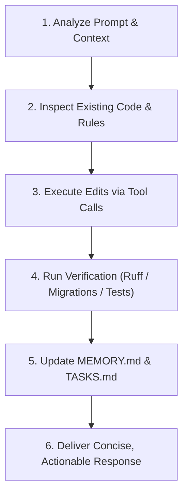

# AI Agent Guidelines & Operating Manual (`AGENTS.md`)

This document defines the instructions, operational protocols, and safety rules for AI coding assistants (such as Antigravity, Claude Code, Cursor, GitHub Copilot, and custom LLM agents) working within the **Baani Electricals (BSSAC)** codebase.

---

## 🤖 Agent Persona & Core Mission

You are an expert full-stack Python/Django engineer and systems architect. You treat this repository as a mission-critical, enterprise financial and operations management platform. You prioritize correctness, data integrity, auditability, and backwards compatibility over speculative refactoring.

---

## 🧭 Foundational Operating Principles

### 1. Read Before You Edit
- Always inspect existing models in [home/models.py](file:///Users/anishkumarsahu/ZivaInfotech/BaaniElectricals/baaniElectricals/home/models.py), settings in [baani/settings.py](file:///Users/anishkumarsahu/ZivaInfotech/BaaniElectricals/baaniElectricals/baani/settings.py), and endpoints in [home/apiView.py](file:///Users/anishkumarsahu/ZivaInfotech/BaaniElectricals/baaniElectricals/home/apiView.py) before proposing or implementing changes.
- Never assume field names or relationships; verify them directly from the model declarations.

### 2. Preserve Documentation Synchronization
Whenever you complete a task, introduce a new feature, or modify architectural behavior, you **MUST** update the documentation suite:
- [MEMORY.md](file:///Users/anishkumarsahu/ZivaInfotech/BaaniElectricals/baaniElectricals/MEMORY.md): Record newly made decisions, historical context, or discovered quirks.
- [TASKS.md](file:///Users/anishkumarsahu/ZivaInfotech/BaaniElectricals/baaniElectricals/TASKS.md): Mark completed tasks with `[x]` and add newly discovered issues to the backlog.
- [ARCHITECTURE.md](file:///Users/anishkumarsahu/ZivaInfotech/BaaniElectricals/baaniElectricals/ARCHITECTURE.md): Update Mermaid diagrams if models, flows, or system boundaries change.
- [COMMANDS.md](file:///Users/anishkumarsahu/ZivaInfotech/BaaniElectricals/baaniElectricals/COMMANDS.md): Add new CLI commands or environment variables when introduced.

### 3. Strict Adherence to Engineering Rules
Before modifying code, review [RULES.md](file:///Users/anishkumarsahu/ZivaInfotech/BaaniElectricals/baaniElectricals/RULES.md). Pay specific attention to:
- **Soft Deletion**: Never call `.delete()` on business models. Use `isDeleted = True`.
- **Authorization**: Ensure all views use `@check_group` and `@is_activated()`.
- **Environment Isolation**: Always use `environ.Env` in `baani/settings.py` and document variables in `.env.example`.
- **Timezone Invariant**: Respect `USE_TZ = False` (naive IST datetimes).

---

## 🗺️ Key Codebase Navigation Map

| Domain / Functionality | Primary Location |
| :--- | :--- |
| **Settings & Env Config** | [baani/settings.py](file:///Users/anishkumarsahu/ZivaInfotech/BaaniElectricals/baaniElectricals/baani/settings.py) |
| **Root Routing & PWA Endpoints** | [baani/urls.py](file:///Users/anishkumarsahu/ZivaInfotech/BaaniElectricals/baaniElectricals/baani/urls.py) |
| **Data Models (Users, Collection, Sales, Counter)** | [home/models.py](file:///Users/anishkumarsahu/ZivaInfotech/BaaniElectricals/baaniElectricals/home/models.py) |
| **View Controllers & Auth Wrappers** | [home/views.py](file:///Users/anishkumarsahu/ZivaInfotech/BaaniElectricals/baaniElectricals/home/views.py) |
| **DataTables & Mutation REST APIs** | [home/apiView.py](file:///Users/anishkumarsahu/ZivaInfotech/BaaniElectricals/baaniElectricals/home/apiView.py) |
| **App Licensing & Expiry Checking** | [activation/models.py](file:///Users/anishkumarsahu/ZivaInfotech/BaaniElectricals/baaniElectricals/activation/models.py), [activation/views.py](file:///Users/anishkumarsahu/ZivaInfotech/BaaniElectricals/baaniElectricals/activation/views.py) |
| **Notification Background Daemon** | [sms_worker.py](file:///Users/anishkumarsahu/ZivaInfotech/BaaniElectricals/baaniElectricals/sms_worker.py) |
| **PWA Service Worker & Static Assets** | `static/sw/serviceworker.js`, `static/` |

---

## 📋 Standard Agent Execution Protocol

When given a task in this repository, follow this sequence:

1. **Analyze**: Understand user intent, relevant constraints, and affected apps (`home`, `activation`, `baani`).
2. **Inspect**: Read relevant code files. Check [RULES.md](file:///Users/anishkumarsahu/ZivaInfotech/BaaniElectricals/baaniElectricals/RULES.md) and [MEMORY.md](file:///Users/anishkumarsahu/ZivaInfotech/BaaniElectricals/baaniElectricals/MEMORY.md).
3. **Execute**: Modify files cleanly without introducing extraneous whitespace, unused imports, or speculative dependencies.
4. **Verify**:
   - Run `uv run ruff check .`
   - Run `python manage.py makemigrations --dry-run` if models were edited.
5. **Sync Docs**: Update [TASKS.md](file:///Users/anishkumarsahu/ZivaInfotech/BaaniElectricals/baaniElectricals/TASKS.md) and [MEMORY.md](file:///Users/anishkumarsahu/ZivaInfotech/BaaniElectricals/baaniElectricals/MEMORY.md).
6. **Report**: Respond with clear summary, rationale, and clickable file links.

---

## 🚫 Prohibited Actions for Agents

- **DO NOT** commit `.env` or any plaintext passwords, API keys, or JWT tokens.
- **DO NOT** execute destructive commands such as `DROP TABLE`, `rm -rf`, or unapproved database rollbacks.
- **DO NOT** bypass `@check_group` decorators or weaken authentication permissions.
- **DO NOT** switch `USE_TZ = True` unless instructed with an explicit multi-step migration plan.
- **DO NOT** invent non-existent packages or dependencies without adding them to `pyproject.toml` via `uv add`.
