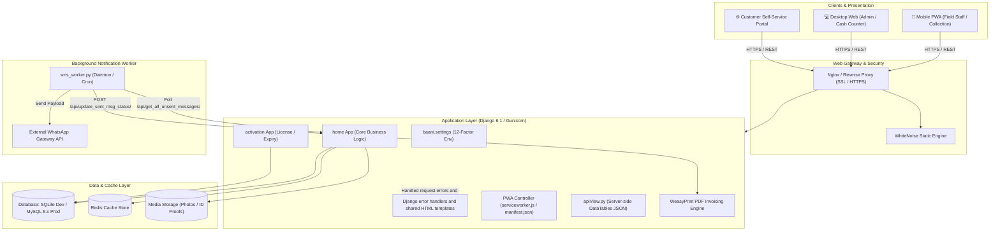
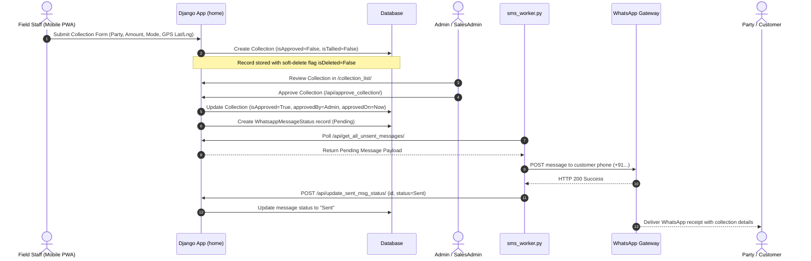
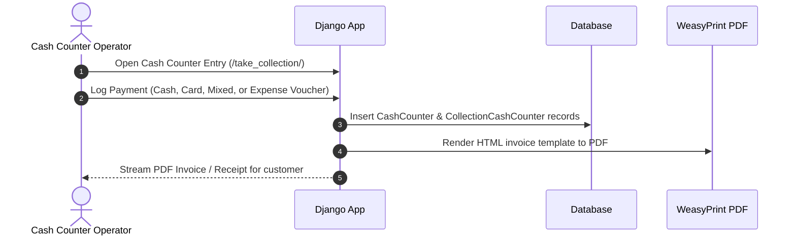
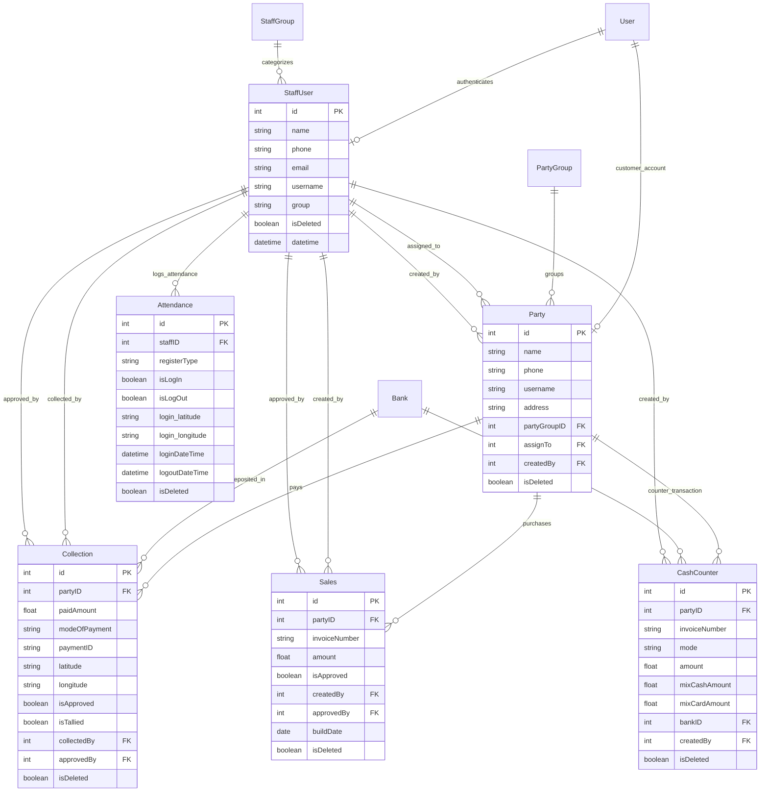
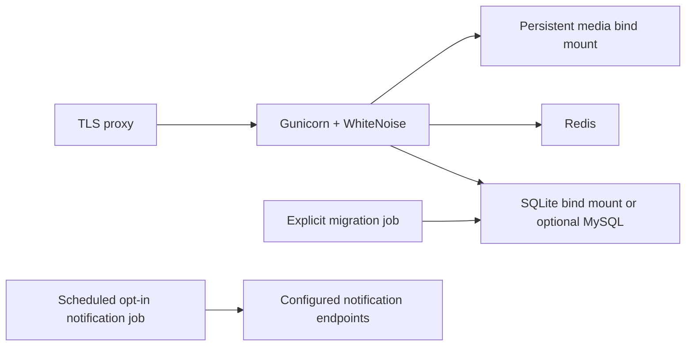

# System Architecture (`ARCHITECTURE.md`)

This document details the architectural topology, data pipelines, application breakdown, and database relationships of the **Baani Electricals (BSSAC)** management platform.

---

## 🏛️ High-Level System Architecture

The following diagram illustrates how clients, web servers, database engines, cache stores, and asynchronous workers interconnect:

---

## 🔄 Core Data & Business Flows

### 1. Field Collection Workflow (GPS-Tagged)

### 2. Daily Cash Counter Operations

---

## 📦 Application Component Breakdown

### 1. `baani` (Project Core)
- **Role**: Coordinates configuration, routing, and deployment settings.
- **Key Modules**:
  - `baani/settings.py`: 12-factor configuration parsed via `django-environ`.
  - `baani/urls.py`: Global URL dispatcher; serves PWA files directly at `/serviceworker.js` and `/manifest.json`.
  - `baani/wsgi.py` & `baani/asgi.py`: Entry points for WSGI and ASGI application servers.
  - `templates/errors/page.html` provides the shared browser layout for Django’s 400, 403, 404, and 500 templates and the CSRF rejection template. Django selects the production 400, 404, and 500 pages with `DEBUG=False`.

### 2. `home` (Business Domain Logic)
- **Role**: Houses the domain models, templates, controllers, and APIs.
- **Key Sub-modules**:
  - `home/models.py`: Primary domain schema (Users, Parties, Collections, Sales, Attendance, Cash Counter).
  - `home/views.py`: Route handlers for admin dashboard, staff collection forms, counter operations, and authentication.
  - `home/apiView.py`: High-density REST-like and DataTables server-side endpoints for asynchronous UI interactions.
  - `home/templatetags/`: Custom filters for currency formatting, date transformations, and role assertions.

### 3. `activation` (Licensing & Validity)
- **Role**: Software licensing guard and subscription expiry enforcement.
- **Key Sub-modules**:
  - `activation/models.py`: `Validity` and `EcomValidity` models storing activation and expiration dates.
  - `activation/views.py`: `is_activated` decorator that wraps protected views and enforces license checks.

### 4. `sms_worker.py` (Background Notification Daemon)
- **Role**: Decoupled message dispatcher running outside the HTTP request/response cycle.
- **Workflow**:
  - Polls unsent notifications via `SMS_FETCH_URL`.
  - Dispatches messages to `SMS_SEND_URL` with bearer token authentication.
  - Acknowledges delivery via `SMS_UPDATE_STATUS_URL`.

---

## 🗄️ Database Entity-Relationship Diagram (ERD)

---

## 🔒 Security Architecture

1. **Authentication & Session Management**:
   - Uses Django standard session cookies with configurable flags: `SESSION_COOKIE_SECURE`, `CSRF_COOKIE_SECURE`, and `SECURE_SSL_REDIRECT`.
2. **Access Control**:
   - Custom decorators (`@check_group`, `@check_two_group`) ensure users only reach views mapped to their Django `auth.Group`.
3. **CSRF Protection**:
   - CSRF middleware active across all state-mutating HTTP POST requests, with configurable `CSRF_TRUSTED_ORIGINS`.
4. **Data Isolation**:
   - Customers (`Customer` group) can only view records referencing their own `Party` identity.
5. **Auditability**:
   - Audit timestamps (`datetime`, `lastUpdatedOn`) and actor foreign keys (`createdBy`, `collectedBy`, `approvedBy`) are logged on financial transactions.

## Container deployment

The application serves uploaded media to authenticated users. The worker runs once per invocation.

Compose places data, media, and MySQL in environment-specific host directories; a one-shot storage initialization service prepares application directory ownership.

Docker releases build a uniquely tagged image, validate migration drift, stop application writers, apply migrations once, then wait for the health probe before declaring success. A host lock serializes releases per stack.

Uploaded media is streamed by Django to authenticated active session users from the existing media bind mount, including when DEBUG is disabled. WhiteNoise handles static files.

- Authenticated media requests read from the sibling media_cdn directory locally or the persistent host bind mount at /media_cdn in Docker.
